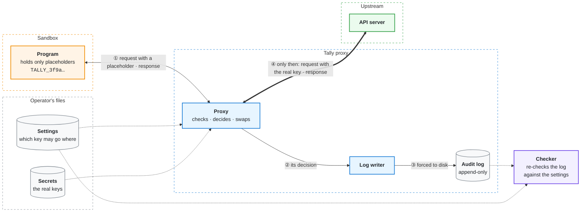

# Tally


Tally is a proxy for sandboxed programs that need to call outside APIs. The program gets placeholders instead of the real API keys, and the proxy swaps a placeholder for its key only after writing its decision to a log on disk.

This project was created as a learning exercise and is not intended for production use.

Status: the v1 design is done (last changed 2026-11-06), and the build is in progress: everything up to the checker (L1 to L7) is written and tested.

## How it works



The program sends its requests through the proxy, with placeholders. For each request, the proxy:

1. checks where the request is going, and that each key in it is allowed to go there;
2. writes its decision to an append-only log and waits until the line is on disk;
3. replaces the placeholders with the real keys and sends the request.

Refused requests are logged too, with a reason. A separate checker reads the log and the settings afterwards and reports any release that broke the rules.

## Why

With v1 I want to learn:
- networking in Rust (tokio) and HTTP, with a parser written from scratch;
- Docker and Docker Compose;
- writing and using Claude skills.

## What v1 guarantees

- The program never receives a real key, unless an allowed API echoes it back (see [Limits of v1](#limits-of-v1)).
- A key is only sent to the host it is allowed for, in the header the operator chose.
- The log line for a key is on disk before the key is sent. If the log can't be written, nothing is sent.
- Every request the proxy starts reading gets one decision line in the log, unless the log can't be written or a shutdown cuts it off first, and refusals say why.

## Limits of v1

- No TLS: plain HTTP, everything on one machine.
- The log can be edited. The checker notices a deleted line or a cut end (which looks like a crash), but not a careful edit.
- If the proxy crashes between writing the line and sending the request, the log shows a key that was never sent.
- The proxy itself is trusted, and so are the allowed APIs: an API that sends a key's header back in its response hands the key to the program.

## Design notes

- The HTTP/1.1 parser is written by hand and is strict: anything ambiguous is refused, to guard against request smuggling.
- One writer owns the log. If writing to disk fails, the proxy stops instead of retrying.
- Each key is tied to one host and one header, set by the operator.
- Timeouts, size limits and status codes were chosen with nginx, Go's `net/http`, hyper, Envoy, and RFC 9110 and 9112 as references.

The design, with the reason for each choice, is in [docs/DESIGN.md](docs/DESIGN.md). Each protocol has a sequence diagram and pseudo code in [docs/protocols/](docs/protocols/).

## Repository layout

| Path | What |
|---|---|
| `tally-core/` | shared library: parser, checks, log format, settings |
| `proxy/` | the proxy |
| `fake-api/`, `fake-program/` | a test API and a test program, for the demo |
| `demo/` | the demo's settings, fake keys and the program's environment |
| `checker/` | re-checks a log against the settings |
| `docs/` | design and protocols |
| `.claude/` | Claude Code settings and Tally's skills |
| `.github/` | CI workflow |

## Testing

CI runs these three commands, then the demo below:

```bash
cargo fmt --all --check
cargo clippy --locked --workspace --all-targets -- -D warnings
cargo test --locked --workspace
```

Three proxy tests exist only on Linux or Unix, so CI and WSL run them and Windows doesn't.

### The demo

The demo runs the real binaries end to end. It works on Linux and WSL, and from Git Bash on Windows, where it runs itself under WSL:

```bash
bash .claude/skills/tally-demo/scripts/demo.sh
```

It starts the fake API and the proxy, runs the fake program's 13 requests through the proxy, stops the proxy, and prints what each one did, the run's log and the checker's report. It exits 0 whatever happens, so read its output, a step that failed is named there.

With `TALLY_DEMO_STRICT=1`, on Linux, it exits with the checker's code instead, or 1 if the program or the proxy failed or a step never ran. CI runs it that way.

In a good run, the proxy and the checker exit with 0 and the log has 16 lines: `start`, 14 decisions (the redirect makes two) and `stop`. Five requests reach the fake API, and the two with a `release` line arrive with the real key.

In Claude Code, `/tally-demo` runs the same script and explains the log request by request.

### The checker

The checker judges one finished run, from its log and the settings file. 

```bash
cargo run -p checker -- demo/logs/<run>.jsonl demo/settings.toml
```

It prints one row per line of the log, the counts by event and reason, then anything it flagged. It exits with 0 for a clean run, 1 if anything is flagged, and 2 if the run couldn't be judged, for example because the settings file isn't the one the run used.

## Commits and CI

Commit messages follow [Conventional Commits](https://www.conventionalcommits.org/en/v1.0.0/): `type(scope): description`, with the types `feat`, `fix`, `test`, `docs`, `refactor`, `ci` and `chore`. The scope is a crate name, left out when a change spans several crates.

Each push and pull request to `main` runs the three commands of [Testing](#testing), then the demo in its strict mode. A Clippy or compiler warning fails the run, and so does anything the checker flags.

## Roadmap

- [x] L0, design: DESIGN.md, and a diagram and pseudo code for each protocol
- [x] L0, setup: workspace, `.gitignore`, `CLAUDE.md`, `git init`, review skill
- [x] L1: fake API
- [x] L2: request and response parsers, with tables of tricky inputs
- [x] L3: loading settings and secrets, and deciding each request
- [x] L4: log writer; the log format is fixed from here on
- [x] L5: proxy loop, with connection-level smuggling tests
- [x] L6: fake program and end-to-end demo
- [x] L7: checker
- [ ] L8: Docker and Compose

Optional: more smuggling tests, and two more Claude skills.
