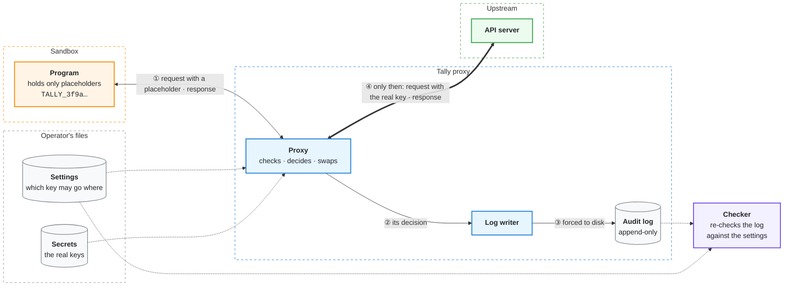

# Tally

Tally is a proxy for sandboxed programs that need to call outside APIs. The program gets placeholders instead of the real API keys, and the proxy swaps a placeholder for its key only after writing its decision to a log on disk.

This project was created as a learning exercise and is not intended for production use.

Status: the v1 design is done (last changed 2026-10-18), and the build has started: the fake API (L1) is written and tested.

## How it works

The program sends its requests through the proxy, with placeholders. For each request, the proxy:

1. checks where the request is going, and that each key in it is allowed to go there;
2. writes its decision to an append-only log and waits until the line is on disk;
3. replaces the placeholders with the real keys and sends the request.

Refused requests are logged too, with a reason. A separate checker reads the log and the settings afterwards and reports any release that broke the rules.

## Why

With v1 I want to learn:
- networking in Rust (tokio) and HTTP, with a parser written from scratch;
- Docker and Docker Compose;
- writing and using Claude skills.

## What v1 guarantees

- The program never receives a real key, unless an allowed API echoes it back (see [Limits of v1](#limits-of-v1)).
- A key is only sent to the host it is allowed for, in the header the operator chose.
- The log line for a key is on disk before the key is sent. If the log can't be written, nothing is sent.
- Every request the proxy starts reading gets one decision line in the log, unless the log can't be written or a shutdown cuts it off first, and refusals say why.

## Limits of v1

- No TLS: plain HTTP, everything on one machine.
- The log can be edited. The checker notices a deleted line or a cut end (which looks like a crash), but not a careful edit.
- If the proxy crashes between writing the line and sending the request, the log shows a key that was never sent.
- The proxy itself is trusted, and so are the allowed APIs: an API that sends a key's header back in its response hands the key to the program.

## Design notes

- The HTTP/1.1 parser is written by hand and is strict: anything ambiguous is refused, to guard against request smuggling.
- One writer owns the log. If writing to disk fails, the proxy stops instead of retrying.
- Each key is tied to one host and one header, set by the operator.
- Timeouts, size limits and status codes were chosen with nginx, Go's `net/http`, hyper, Envoy, and RFC 9110 and 9112 as references.

The design, with the reason for each choice, is in [docs/DESIGN.md](docs/DESIGN.md). Each protocol has a sequence diagram and pseudo code in [docs/protocols/](docs/protocols/).

## Repository layout

| Path | What |
|---|---|
| `tally-core/` | shared library: parser, checks, log format, settings |
| `proxy/` | the proxy |
| `fake-api/`, `fake-program/` | a test API and a test program, for the demo |
| `checker/` | re-checks a log against the settings |
| `docs/` | design and protocols |
| `.claude/` | Claude Code settings and Tally's skills |
| `.github/` | CI workflow |

## Commits and CI

Commit messages follow [Conventional Commits](https://www.conventionalcommits.org/en/v1.0.0/): `type(scope): description`, with the types `feat`, `fix`, `test`, `docs`, `refactor`, `ci` and `chore`. The scope is a crate name, left out when a change spans several crates.

Each push and pull request to `main` runs `cargo fmt --check`, `cargo clippy --all-targets` and `cargo test`. A Clippy or compiler warning fails the run.

## Roadmap

- [x] L0, design: DESIGN.md, and a diagram and pseudo code for each protocol
- [x] L0, setup: workspace, `.gitignore`, `CLAUDE.md`, `git init`, review skill
- [x] L1: fake API
- [x] L2: request and response parsers, with tables of tricky inputs
- [x] L3: loading settings and secrets, and deciding each request
- [ ] L4: log writer; the log format is fixed from here on
- [ ] L5: proxy loop, with connection-level smuggling tests
- [ ] L6: fake program and end-to-end demo
- [ ] L7: checker
- [ ] L8: Docker and Compose

Optional: more smuggling tests, and two more Claude skills.
